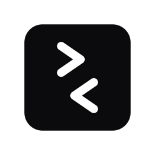
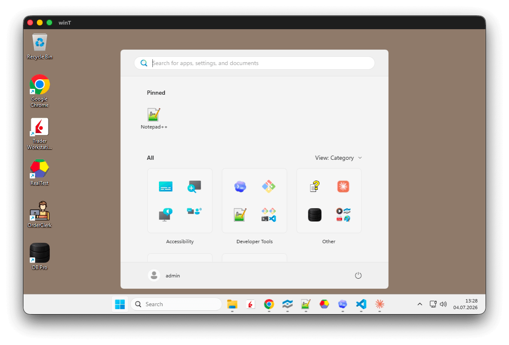
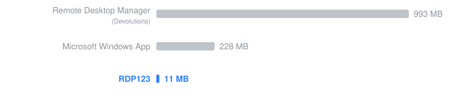
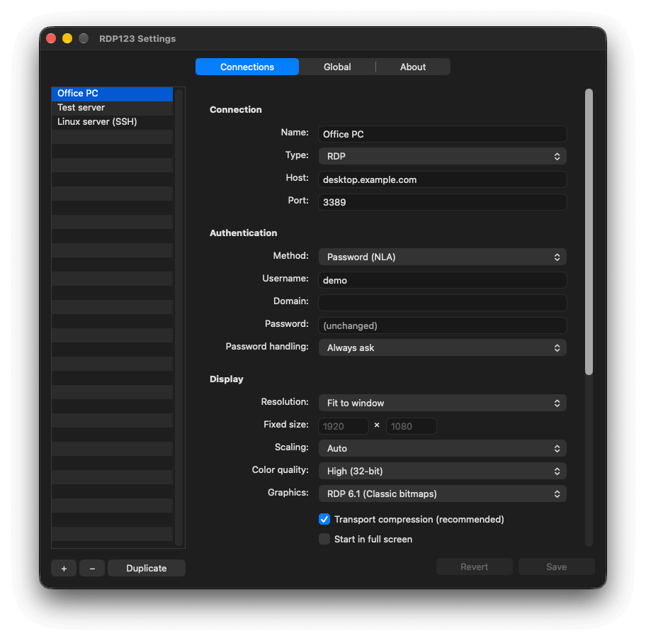
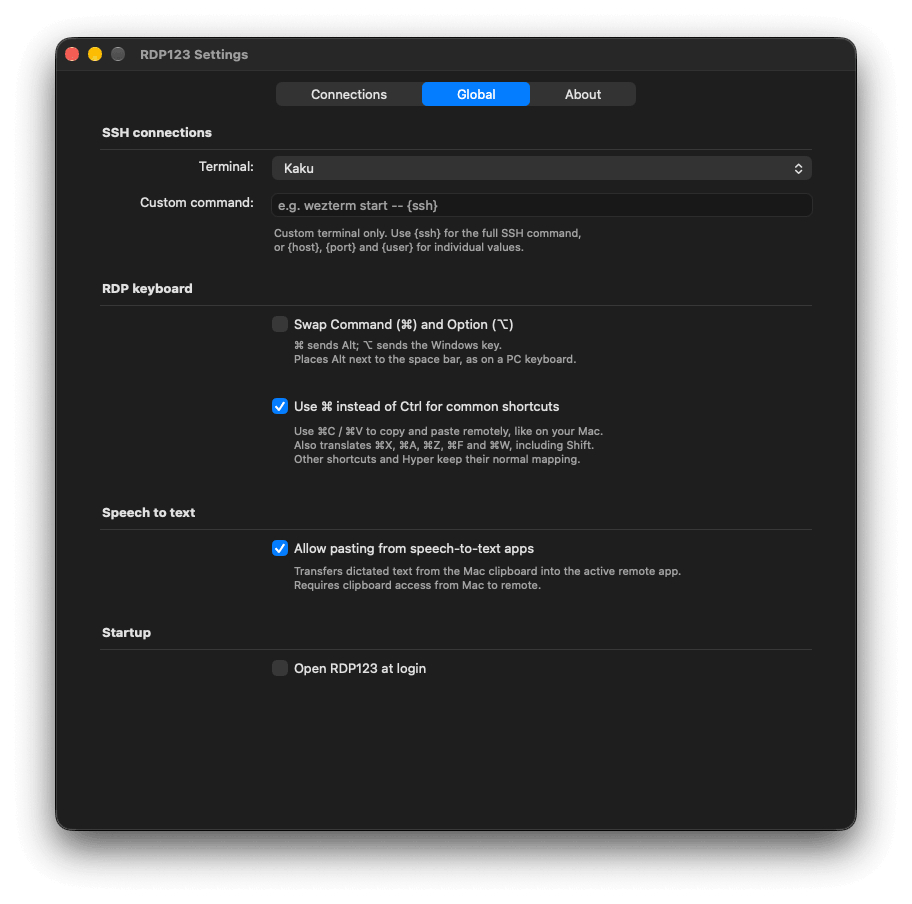

<p align="center">
  
</p>

<h1 align="center">RDP123</h1>

<p align="center">
  A minimal, fast, and responsive <strong>RDP client for macOS</strong>, built in Rust.
</p>

<p align="center">
  
  <a href="LICENSE"></a>
  
  
  <a href="#privacy"></a>
</p>

<p align="center">
  <a href="#features">Features</a> ·
  <a href="#install">Install</a> ·
  <a href="#usage">Usage</a> ·
  <a href="#security">Security</a> ·
  <a href="#privacy">Privacy</a> ·
  <a href="#credits">Credits</a>
</p>

RDP123 lives in the menu bar and opens each saved connection in a clean native
window. While sessions are open, they appear in the Dock and ⌘-Tab; when the
last one closes, the app quietly returns to the menu bar.

<p align="center">
  
</p>

## Why RDP123

RDP123 is a native AppKit app written in Rust, with no Electron or bundled
browser. It focuses on everyday remote access rather than enterprise
management and occupies about 11 MB when installed.

<p align="center">
  
</p>

RDP123's size is measured from v0.7.1; comparison app sizes are from mid-2026.

Classic RDP 6.1 graphics is the default. Experimental RDP 8 graphics, including
H.264, can be enabled per connection.

## Features

- Manage multiple sessions through native windows, the Dock, and ⌘-Tab.
- Use Retina-aware resizing, fixed resolutions, remembered window sizes,
  full screen, and native remote cursors.
- Copy text, files, and folders in both directions, with per-connection
  clipboard controls.
- Paste text from external speech-to-text apps into the active remote app.
- Play remote audio on the Mac, leave it on the remote computer, or disable it.
- Use non-US keyboard layouts and optional Mac-style ⌘ shortcuts.
- Configure automatic reconnect, Wake on LAN, and optional session keep-alive.
- Sign in with a password or Microsoft Entra web authentication.
- Create and duplicate RDP or SSH profiles in native Settings.
- Open SSH connections in your preferred terminal using existing keys and config.

## Requirements

- A Mac with Apple Silicon (M1 or newer) and macOS 11 or newer. Intel Macs are
  not supported.
- A Windows host accepting password-based NLA or RDS AAD Auth. Entra mode
  requires the device hostname, not an IP address.

## Install

Install with [Homebrew](https://brew.sh):

```sh
brew install --cask asd123ch/tap/rdp123
```

Update to the latest version:

```sh
brew upgrade --cask rdp123
```

Without Homebrew, download the DMG from
[Releases](https://github.com/asd123ch/rdp123/releases/latest) and drag RDP123
into Applications. Releases are signed with a Developer ID and notarized by
Apple.

### Updates

With **Settings → Global → Check for updates automatically** (on by default),
RDP123 asks GitHub once a day for a newer version. When one exists, the menu
shows **Update to RDP123 …**. **Settings → About → Check for Updates** checks
at any time. RDP123 never downloads or installs anything itself.

## Build from source

Most people should install with Homebrew. To build RDP123 yourself, you need
the Xcode Command Line Tools (`xcode-select --install`) and Rust 1.94 or newer
via [rustup](https://rustup.rs).

<details>
<summary>Build and install from source</summary>

```sh
git clone https://github.com/asd123ch/rdp123.git
cd RDP123
scripts/make-signing-identity.sh   # one-time: stable local signing identity
cargo xtask install                # release build, sign, install in /Applications
open /Applications/RDP123.app
```

Use `cargo xtask bundle` to create `dist/RDP123.app` without installing.
Run the signing helper once to keep macOS permissions stable across builds.

</details>

<details>
<summary>Back up a source build and restore a previous one</summary>

Quit RDP123 before updating. Keep the signed app and a separate profile backup
outside the repository:

```sh
backup="$HOME/Library/Application Support/RDP123/Backups/$(date +%Y%m%d-%H%M%S)"
mkdir -p -m 700 "$backup"
ditto -c -k --sequesterRsrc --keepParent /Applications/RDP123.app "$backup/RDP123.app.zip"
cp "$HOME/Library/Application Support/ch.asd123.RDP123/connections.json" "$backup/connections.json"
chmod 600 "$backup/connections.json"
```

To check or restore the app, keep `backup` set to the chosen backup directory:

```sh
restore="$(mktemp -d)"
ditto -x -k "$backup/RDP123.app.zip" "$restore"
codesign --verify --deep --strict "$restore/RDP123.app"
open "$restore"
```

For rollback, quit RDP123, move the current app out of `/Applications`, then
move the verified extracted app into `/Applications` and launch it. Do not
merge app bundles. Replacing the app does not replace profiles or Keychain
passwords; restore `connections.json` separately only if needed. Backups may
contain private connection details and must never be committed or published.

</details>

<details>
<summary>Local signing and bundle details</summary>

Running `scripts/make-signing-identity.sh` once is strongly recommended. macOS
ties the Keychain **Always Allow** decision and **Local Network** permission to
the app's code identity. An ad-hoc identity changes with every build, causing
repeated prompts and potentially a failed first LAN connection after rebuilding.

The script is non-interactive, free, and requires no Apple account. It creates
a self-signed **RDP123 Local** certificate with a non-extractable private key in
a dedicated keychain; it never uses your login keychain.

Both build commands use **RDP123 Local** when available, otherwise an ad-hoc
signature (`-`). The bundle includes the AGPLv3 license under
`Contents/Resources`. Bundling replaces home and workspace paths with generic
build paths and refuses binaries that still contain either original path.

The signing keychain is
`~/Library/Keychains/rdp123-signing.keychain-db`. Its random password is kept in
a user-only file at
`~/Library/Application Support/RDP123/signing-keychain-password`, and only
Apple's signing tools are authorized to use the private key. The build unlocks
this keychain automatically without a GUI prompt.

Remove the local identity with:

```sh
security delete-keychain ~/Library/Keychains/rdp123-signing.keychain-db
rm -f "$HOME/Library/Application Support/RDP123/signing-keychain-password"
```

Use your own identity with
`RDP123_SIGN_IDENTITY="My Identity" cargo xtask bundle`. A local build remains
unnotarized, which is unnecessary when running it on the Mac that built it.

</details>

<details>
<summary>First connection prompts and Keychain troubleshooting</summary>

- **Local Network:** click **Allow** when macOS asks whether RDP123 may find
  local devices. RDP123 briefly retries TCP reachability after approval, but
  never retries authentication, certificate, or protocol failures, avoiding
  accidental account lockouts.
- **Keychain:** with stable signing, save a password and click **Always Allow**
  once. If macOS rejects your login password, the login keychain password is
  out of sync; update it in *Keychain Access* → right-click **login** → *Change
  Password for Keychain "login"…*. Choose **Password handling → Always ask**
  to store no password at all.

</details>

## Usage

1. Open the menu-bar **RDP** item → **Settings…**.
2. Under **Connections**, choose **+**, enter the host and login details, and
   **Save**. Use **Duplicate** to copy an existing profile.
3. Under **Global**, choose the SSH terminal, optional ⌘/⌥ swap, Mac shortcuts,
   speech-to-text paste, whether RDP123 starts at login, and automatic update
   checks.
4. Select a saved connection from the menu to connect. RDP asks you to trust a
   new server key before signing in; Entra mode opens Microsoft login and MFA.

Selecting an already open RDP connection brings its window forward, including
while reconnecting. Right-click the Dock icon to list open sessions; the
frontmost session is marked. Duplicate a profile if you need a second session
with the same settings.

<p align="center">
  
</p>

<p align="center">
  
</p>

<details>
<summary>Connection options and profile editing</summary>

Each RDP profile controls display, colour depth, scaling, graphics, compression,
clipboard, audio, authentication, reconnect behavior, and password handling.
Audio plays on the Mac by default. Wake on LAN uses the host's MAC address;
**Keep session awake**, off by default, sends an invisible key tap while idle.

**Revert** discards edits; switching profiles with unsaved changes asks first.
**Duplicate** creates an independent profile with a "Copy" suffix, including any
saved password. The copy requires its own server-key trust confirmation.
The **About** tab shows the installed version and libraries.

</details>

### Clipboard and speech to text

Copy and paste text, files, and folders between Mac and Windows. Keep the
session open until file transfers finish. Clipboard direction can be restricted
or disabled per connection.

For dictation tools, enable **Settings → Global → Allow pasting from
speech-to-text apps** and allow Mac-to-remote clipboard access on the connection.
Use a dictation shortcut without the key mapped to Windows, such as ⌃+⇧+A.

<details>
<summary>Clipboard transfer details</summary>

Windows files are fetched in chunks when Finder or another app requests their
file URLs. Speech-to-text support accepts the standard macOS Paste action,
waits for Windows to confirm the matching clipboard text, then sends Ctrl+V.

</details>

### Local data

- Connection names, hosts, options, and pinned server keys:
  `~/Library/Application Support/ch.asd123.RDP123/connections.json`.
- Passwords: macOS Keychain service `ch.asd123.rdp123`, never the profile file.

### SSH terminals

SSH entries use your keys and `~/.ssh/config`. Select a terminal under
**Settings → Global**.

<details>
<summary>Supported terminal launch methods</summary>

- **Terminal.app / iTerm2:** AppleScript through `osascript`.
- **Kaku / WezTerm:** `<cli> start -- ssh …`; binaries are found on `PATH`, in
  Homebrew locations, or inside the application bundle.
- **Ghostty / Alacritty:** `open -na <App> --args -e ssh …`.
- **Custom:** a `/bin/sh -c` template with `{ssh}`, `{host}`, `{port}`, and
  `{user}` placeholders.

</details>

### Keyboard and Karabiner

RDP123 supports physical key mapping, including non-US layouts such as Swiss
German. [Karabiner-Elements](https://karabiner-elements.pqrs.org) rules also
affect keys sent to the remote session; excluding RDP123 from a rule disables
that rule while an RDP123 window is active.

For PC key positions inside sessions, enable **Settings → Global → Swap ⌘ and
⌥**. Then ⌘ acts as Alt and ⌥ as the Windows key. It is off by default.

**Settings → Global → Use ⌘ instead of Ctrl for common shortcuts** optionally sends
⌘C, ⌘V, ⌘X, ⌘A, ⌘Z, ⌘F and ⌘W as Ctrl shortcuts, including Shift variants.
It is off by default and also works with the ⌘/⌥ swap enabled. Other ⌘ keys,
a ⌘ tap, and combinations with Control or Option keep their normal mapping.

<details>
<summary>Keyboard mapping details</summary>

Shortcut detection follows the Mac keyboard layout, with physical US key
positions as a fallback for non-Latin layouts. Windows still interprets the
original physical key using its own layout. External STT paste takes priority
for ⌘V when enabled. RDP123 releases modifiers when switching applications.

</details>

<details>
<summary>Hyper key opens Microsoft 365 Copilot or Office</summary>

A macOS Hyper key commonly sends ⌘+⌃+⌥+⇧. In a Windows session, this becomes
the Windows+Ctrl+Alt+Shift shortcut reserved for Microsoft Office. If pressing
Hyper opens Microsoft 365 Copilot or Office, disable that shortcut for the
current Windows user from PowerShell:

```powershell
reg add "HKCU\Software\Classes\ms-officeapp\Shell\Open\Command" /t REG_SZ /d rundll32 /f
```

Restart Windows Explorer, or sign out and back in, for the change to take
effect. A reboot is not required. To restore the default behavior:

```powershell
reg delete "HKCU\Software\Classes\ms-officeapp\Shell" /f
```

Restart Windows Explorer, or sign out and back in, once more. This registry
workaround is described in
[Microsoft Q&A](https://learn.microsoft.com/en-us/answers/questions/4331341/disabling-the-office-hotkey-in-windows-10).

</details>

## Security

- **Passwords:** macOS Keychain only; never profiles or logs.
- **Transport:** TLS 1.2+ through rustls with either NLA (CredSSP/NTLM) or RDS
  AAD Auth, negotiated before the session starts.
- **Entra:** access tokens are bound to a fresh 2048-bit RSA
  proof-of-possession key. Tokens and private keys remain in process memory.
  Web authentication for Entra-joined Windows 11 hosts is equivalent to
  `enablerdsaadauth:i:1`.
- **Server identity:** on first connection, RDP123 displays the server public
  key's SHA-256 fingerprint before sending credentials. The key is pinned and a
  later mismatch is reported. Pinning the key rather than the certificate
  avoids prompts for routine certificate renewals using the same key.
- **Reduced attack surface:** no listening ports or drive, printer, microphone,
  or smart-card redirection. Clipboard and remote audio are optional.

## Privacy

- No telemetry, analytics, crash reporting, advertising, tracking, accounts,
  automatic downloads, hosted control plane, or hidden background listener.
- No data is sent to the developer. RDP connects only to the configured host;
  SSH invokes the local client; Entra mode contacts
  `login.microsoftonline.com` for Microsoft authentication and its RDP token.
- The update check requests the latest release from `api.github.com` once a
  day. It sends only the app version in its user agent and can be turned off.
- Clipboard and audio move only when enabled for that connection.

## Architecture

<details>
<summary>Components, rendering, and graphics codecs</summary>

- **`rdp123-core`:** profiles, Keychain integration, RDP engine, input, resize,
  clipboard, shared framebuffer, and macOS-to-RDP scan-code mapping. It is
  unit-tested without AppKit.
- **`rdp123-app`:** native AppKit UI, menu-bar and Dock integration, windows,
  IOSurface/CoreAnimation rendering, input, and system-WebKit Entra login.

Each session owns a thread with a single-threaded Tokio runtime. Commands move
to the session over a channel; frame, clipboard, trust, and disconnect events
return to the main thread through GCD. The session never touches AppKit and the
UI never speaks RDP.

The first frame after idle is presented immediately. Frame bursts are coalesced
in an 8 ms window, supporting up to 120 fps on ProMotion displays. Dirty-region
tracking copies only changed pixels; pooled IOSurfaces and CoreAnimation avoid
per-frame image allocation, full-frame copies, and texture uploads. Remote
cursor shapes, including I-beam, hand, and resize arrows, use the native cursor.

The experimental RDP 8 pipeline uses IronRDP's decoders for H.264/AVC420,
RemoteFX Progressive, ClearCodec with NSCodec, and Planar, with cache-driven
compositing and ZGFX compression. Microsoft Entra login uses the system WebKit
framework only while authenticating.

</details>

## Known limitations

- Tested primarily with current Windows 10/11 hosts over direct connections;
  RDS farms and gateways may have rough edges.
- Entra authentication currently targets the public Microsoft cloud; sovereign
  cloud endpoints are not configurable.
- External speech-to-text shortcuts must not include the macOS modifier mapped
  to the Windows key inside the session: ⌘ by default, or ⌥ when **Swap ⌘ and
  ⌥** is enabled. Use a shortcut such as ⌃+⇧+A instead.
- Experimental RDP 8 graphics can show compositing artifacts; Classic remains
  the reliable default.
- Clipboard images, microphone input, multi-monitor, and console/admin sessions
  are not implemented. Audio is remote-to-local uncompressed PCM only.
- Mac-to-Windows file copies allow up to 4,096 entries per selection. Symbolic
  links and paths unsupported by Windows are rejected; archive these selections
  first or copy them in smaller groups.

## Development

Issues and focused pull requests are welcome. Do not attach credentials,
hostnames, captured RDP traffic, or private desktop screenshots. Keep vendored
IronRDP changes narrow and documented for future upstreaming or rebasing.

CI checks formatting, tests, Clippy, bundling, and dependencies:

```sh
cargo fmt --all -- --check
cargo test --workspace --all-targets --locked
cargo clippy --workspace --all-targets --all-features --locked -- -D warnings
cargo audit --ignore RUSTSEC-2023-0071 -D warnings
```

`RUSTSEC-2023-0071` is an unavoidable transitive advisory in the current
IronRDP/SSPI graph. It concerns RSA private-key operations; password-based NTLM
does not load an RSA private key, while Entra proof-of-possession signing uses
AWS-LC rather than the affected transitive implementation. The explicit
exception keeps other advisories visible and can be removed after an upstream
update.

## Credits

### Contributors

- [willie](https://github.com/willie)

### Open-source libraries

- [IronRDP](https://github.com/Devolutions/IronRDP) — RDP protocol, channels,
  and graphics pipeline.
- [rustls](https://github.com/rustls/rustls) and
  [AWS-LC](https://github.com/aws/aws-lc-rs) — TLS and cryptography.
- [Tokio](https://github.com/tokio-rs/tokio) — asynchronous networking.
- [objc2](https://github.com/madsmtm/objc2) — native Apple-framework bindings.
- [OpenH264](https://github.com/cisco/openh264),
  [openh264-rs](https://github.com/ralfbiedert/openh264-rs), and
  [CPAL](https://github.com/RustAudio/cpal) — AVC420 and audio playback.
- RustCrypto, serde, tracing, and the wider Rust ecosystem.

Third-party copyright remains with its authors. `Cargo.lock` and crate metadata
record the locked dependency versions and licenses. Modified vendored IronRDP
components retain their MIT/Apache-2.0 license files under `vendor/`.

## License

Copyright (c) 2026 asd123.ai

RDP123 is licensed under the
[GNU Affero General Public License, version 3](LICENSE). You may use, study,
modify, and redistribute it under those terms. If you make a modified version
available to others over a network, you must also offer its corresponding
source. Third-party components remain under their own licenses.
